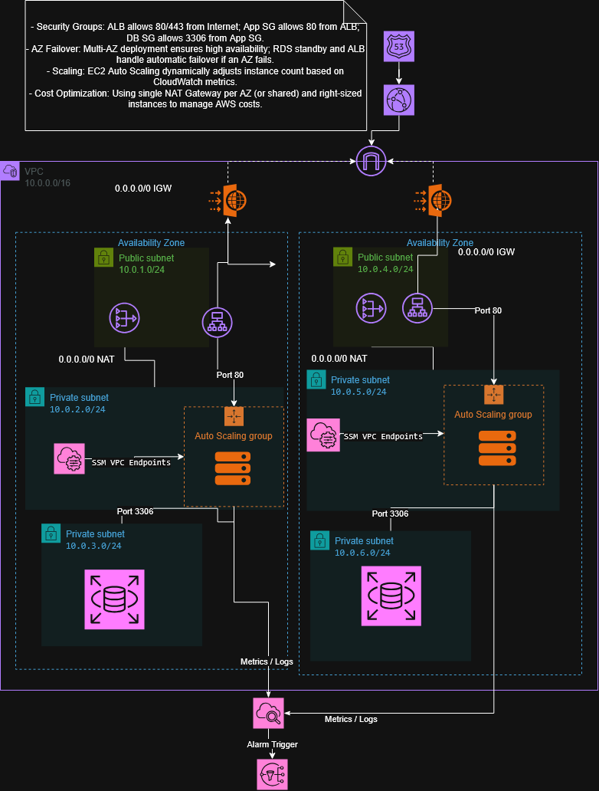

# Scalable and Secure AWS Web Application Architecture

## Overview

This project presents a proposed AWS reference architecture for a public web application designed to combine high availability, scalability, and security.

The architecture uses multiple Availability Zones, an Application Load Balancer, an EC2 Auto Scaling Group, and Amazon RDS for MySQL Multi-AZ deployment.

Security is addressed through network segmentation, restrictive Security Groups, AWS WAF, HTTPS termination at the ALB, and private database subnets.

This is a documentation-only project. No AWS resources have been deployed.

## Architecture Diagram

[View the editable diagrams.net source](diagrams/architecture.drawio)

## Architecture Components

| Component | Purpose |
|---|---|
| Amazon Route 53 | DNS routing for the public website |
| Amazon CloudFront | Content delivery and caching |
| AWS WAF | Web request filtering at the ALB |
| Application Load Balancer | Distributes incoming requests across healthy targets |
| Amazon EC2 Auto Scaling | Adjusts application capacity based on demand |
| Amazon RDS for MySQL Multi-AZ | Managed relational database with high availability |
| Amazon VPC | Isolates the network environment |
| NAT Gateways | Provide outbound internet access for private application instances |
| AWS Systems Manager | Private administrative access to EC2 |
| Amazon CloudWatch | Metrics, monitoring, and alarms |
| Amazon SNS | Delivers alarm notifications |

## Key Design Decisions

- Deploy the network across two Availability Zones.
- Separate public, application-private, and database-private subnets.
- Keep application instances and the database off public IP addresses.
- Terminate HTTPS at the Application Load Balancer.
- Restrict database access to the application tier.
- Scale the application using ALB requests per target.
- Use a NAT Gateway in each AZ for AZ-local outbound traffic.
- Use Systems Manager instead of exposing SSH to the internet.

## Detailed Documentation

- [Network Design](docs/network-design.md)
- [Security Design](docs/security-design.md)
- [Traffic Flows](docs/traffic-flows.md)
- [Availability and Failure Scenarios](docs/availability-and-failures.md)
- [Monitoring and Scaling](docs/monitoring-and-scaling.md)
- [Cost and Trade-offs](docs/cost-and-tradeoffs.md)

## Scope and Limitations

This repository documents a proposed architecture and its design decisions. It does not include a deployed application, live AWS infrastructure, infrastructure-as-code, or production test results.

Expected behavior and failure scenarios are design analyses, not results from live testing.
